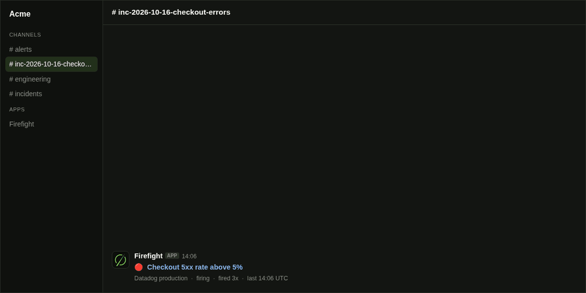
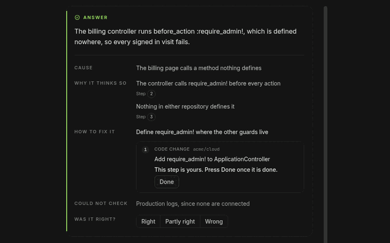
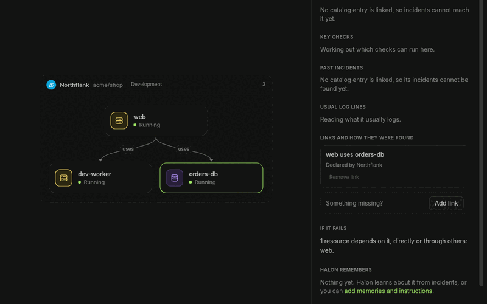

<p align="center">
  <a href="https://firefight.app">
    <picture>
      <source media="(prefers-color-scheme: dark)" srcset=".github/assets/readme-hero-dark.svg" />
      <source media="(prefers-color-scheme: light)" srcset=".github/assets/readme-hero-light.svg" />
      
    </picture>
  </a>
</p>

<h3 align="center">Halon is an open-source AI SRE that works your incidents in Slack.</h3>

<p align="center">
  It links every fact to where it came from, and it changes nothing your team has not approved.
</p>

<p align="center">
  <a href="LICENSE"></a>
  <a href="https://github.com/FireFightLabs/firefight/actions/workflows/ci.yml"></a>
  <a href="https://firefight.app/docs"></a>
</p>

<p align="center">
  <a href="https://firefight.app"><b>Cloud</b></a>
  &nbsp;·&nbsp;
  <a href="SELF_HOSTING.md"><b>Self-host</b></a>
  &nbsp;·&nbsp;
  <a href="https://firefight.app/docs"><b>Docs</b></a>
  &nbsp;·&nbsp;
  <a href="https://firefight.app/slack"><b>Community</b></a>
</p>

<br />

<p align="center">
  
</p>

<p align="center"><sub>
  At 14:06 an alert says checkout is failing. Three minutes later Halon has traced it to a deploy that cut the database pool from 20 to 5.<br />
  Maya asks for the fix in the thread, approves it, and Halon opens the pull request.
</sub></p>

<br />

## What it does

**It investigates where you already are.** Run `/ff investigate`, or let an alert that opens an incident start Halon for you. You watch a checklist tick over while it reads recent deploys, logs and metrics, the code that was running and your database, all through the tools you connected.

**It tells you how sure it is.** The answer names the cause and the fix, links every fact back to the page it came from, and says whether Halon is very sure or guessing. If it could not check something, it says so.

**It asks before it changes anything.** A fix runs through Firefight's own tools, or as a pull request written in a throwaway sandbox. Each change shows up as a card saying what Halon wants to do, and it runs once someone approves it in Slack. Your approval rules decide who that can be. Reads never wait, and every call to your connected tools, read or change, lands in the activity log.

**It runs the rest of the incident too.** Channels, roles, a timeline, paging through PagerDuty or Opsgenie, status page updates, workflows and a postmortem drafted from what actually happened. Halon is one part of a full incident platform you can host yourself.

<br />

<table>
  <tr>
    <td width="50%" valign="top"></td>
    <td width="50%" valign="top"></td>
  </tr>
  <tr>
    <td valign="top"><sub>The full reasoning behind every answer, in the dashboard.</sub></td>
    <td valign="top"><sub>What runs where, read from the providers you connect.</sub></td>
  </tr>
</table>

## Get started

The quickest way is [Firefight Cloud](https://firefight.app). Sign in with Slack and you are running.

To host it yourself you need a machine with Docker, a hostname pointing at it, and a Slack workspace where you can install an app.

1. **Create the Slack app** from [`config/slack_manifests/template.yml`](config/slack_manifests/template.yml), with your address in place of `<base-url>`.
2. **Fill in `.env`** from [`.env.selfhost.example`](.env.selfhost.example). It needs your hostname, a Postgres password, the Slack app's three keys and the secrets these print:
   ```sh
   docker run --rm ghcr.io/firefightlabs/firefight:latest bin/rails secret
   docker run --rm ghcr.io/firefightlabs/firefight:latest bin/rails db:encryption:init
   ```
3. **Start it** with `docker compose up -d`, sign in with Slack at your address, and run `/ff new` in any channel.

[SELF_HOSTING.md](SELF_HOSTING.md) walks through each step and covers AI keys, sandboxes for code fixes, upgrades and backups.

## Learn more

- [How Halon works](https://firefight.app/docs/ai/halon) and [how an investigation runs](https://firefight.app/docs/ai/investigations)
- [Permissions and approvals](https://firefight.app/docs/gateway/overview), and [what reaches the AI](https://firefight.app/docs/ai/data-handling)
- [Connecting your tools](https://firefight.app/docs/api/integrations), or any MCP server
- [The REST API](https://firefight.app/docs/api/overview) and [Firefight's own MCP server](https://firefight.app/docs/api/mcp-server)
- [Contributing](CONTRIBUTING.md) and [reporting a vulnerability](SECURITY.md)

Firefight is young and changes fast. Each version is tagged from `main` and published to `ghcr.io/firefightlabs/firefight`, the same image our cloud runs. Slack is the only chat platform for now. Questions, or thinking of running it at your company? Write to **hello@firefight.app**.

## License

[AGPL-3.0](LICENSE). Use it, host it and change it. If you run a changed version as a service, share your changes under the same license.
