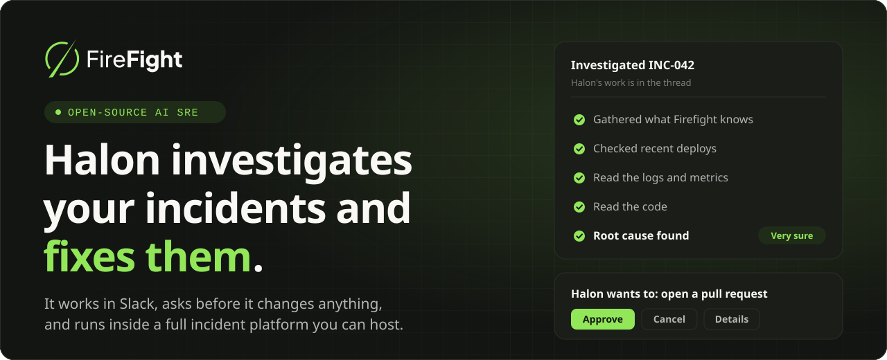
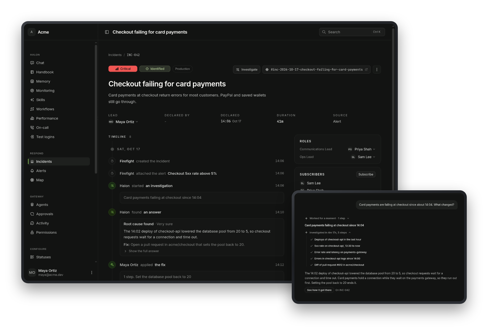
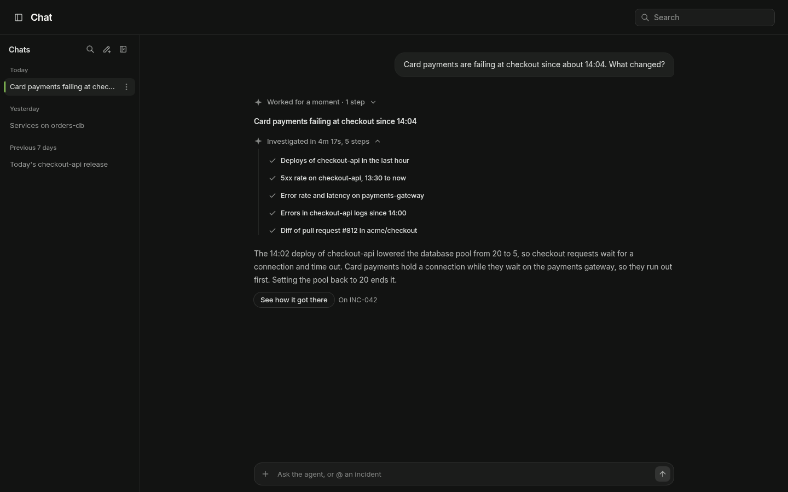
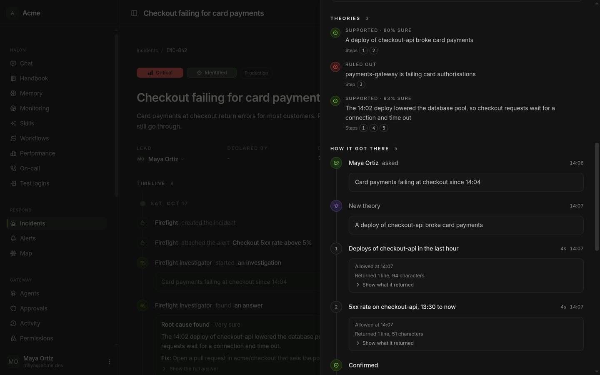
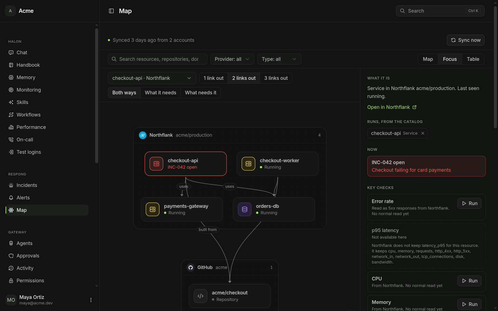
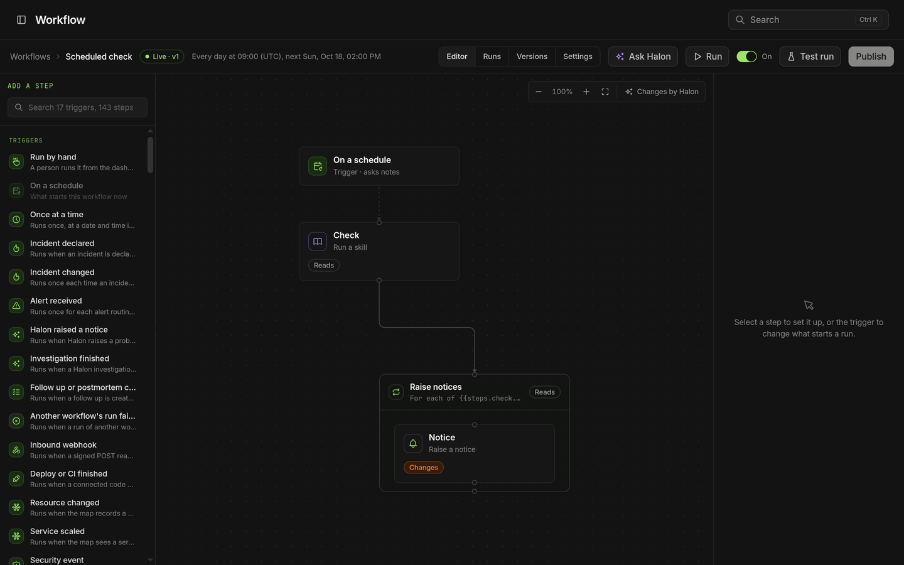

<p align="center">
  <a href="https://firefight.app">
    <picture>
      <source media="(prefers-color-scheme: dark)" srcset=".github/assets/readme-hero-dark.svg" />
      <source media="(prefers-color-scheme: light)" srcset=".github/assets/readme-hero-light.svg" />
      
    </picture>
  </a>
</p>

<h4 align="center">
  <a href="https://firefight.app">Website</a> ·
  <a href="https://firefight.app/docs">Docs</a> ·
  <a href="SELF_HOSTING.md">Self-hosting</a> ·
  <a href="CONTRIBUTING.md">Local development</a> ·
  <a href="https://github.com/FireFightLabs/firefight/releases">Releases</a> ·
  <a href="https://firefight.app/slack">Community</a>
</h4>

<h4 align="center">
  <a href="https://github.com/FireFightLabs/firefight/blob/main/LICENSE">
    
  </a>
  <a href="https://github.com/FireFightLabs/firefight/actions/workflows/ci.yml">
    
  </a>
  <a href="https://github.com/FireFightLabs/firefight/blob/main/CONTRIBUTING.md">
    
  </a>
  <a href="https://firefight.app/slack">
    
  </a>
  <a href="https://x.com/firefightapp_">
    
  </a>
</h4>

<br />

<p align="center">
  
</p>

<br />

## What it does

Root cause fast, every finding backed by evidence. Fixes ship through an approval gateway with a full audit trail.

**Investigation in the incident channel.** An alert can start a run on its own, or anyone runs `/ff investigate`. Halon reads recent deploys, logs, metrics, the running code and your databases through the tools you connect, and posts its progress as a live checklist.

**Evidence-backed answers.** Every conclusion ships with a confidence level and the evidence behind it, each fact linked to its source. Gaps in coverage are reported alongside the answer.

**Fixes through an approval gateway.** Fixes run through FireFight's own tools or as a pull request written in an isolated sandbox. Reads are immediate. Changes require sign-off in Slack, under the approval rules your admins set, and every call to a connected tool is recorded in the activity log.

**A complete incident platform.** Declaration, roles, paging through PagerDuty and Opsgenie, status pages, workflows and postmortems drafted from the timeline. Self-hosted or on [firefight.app](https://firefight.app).

## What Halon knows

Halon starts every run from your team's context: the resource map of what runs where, read live from your connected tools, the service catalog with owners, the handbook your team writes and approves, memory of past incidents that a person confirms, and every past incident and postmortem. [How context works](https://firefight.app/product/context).

<table>
  <tr>
    <td width="50%"></td>
    <td width="50%"></td>
  </tr>
  <tr>
    <td width="50%"></td>
    <td width="50%"></td>
  </tr>
</table>

## Get started

To use FireFight Cloud, sign up at [app.firefight.app](https://app.firefight.app) with Slack, Google or email, then add FireFight to your Slack workspace. Nothing to install or host.

To self-host, you need a machine with Docker, a hostname and a Slack workspace.

1. **Create the Slack app** from [`config/slack_manifests/template.yml`](config/slack_manifests/template.yml), with your address in place of `<base-url>`.
2. **Fill in `.env`** from [`.env.selfhost.example`](.env.selfhost.example): your hostname, a Postgres password, the Slack app's three keys, and the secrets these print.
   ```sh
   docker run --rm ghcr.io/firefightlabs/firefight:latest bin/rails secret
   docker run --rm ghcr.io/firefightlabs/firefight:latest bin/rails db:encryption:init
   ```
3. **Start it** with `docker compose up -d`. Sign in with Slack at your address and run `/ff new`.

[SELF_HOSTING.md](SELF_HOSTING.md) covers AI keys, code sandboxes, upgrades and backups.

## We ship fast

In the last 30 days we merged more than 400 pull requests and tagged 49 releases. Every version is published to `ghcr.io/firefightlabs/firefight`, the same image FireFight Cloud runs. The [changelog](https://firefight.app/changelog) has the details.

## Learn more

- [Halon](https://firefight.app/docs/ai/halon) and [investigations](https://firefight.app/docs/ai/investigations)
- [Permissions and approvals](https://firefight.app/docs/gateway/overview) and [what reaches the AI](https://firefight.app/docs/ai/data-handling)
- [Integrations](https://firefight.app/docs/api/integrations), plus any MCP server
- [REST API](https://firefight.app/docs/api/overview) and [FireFight's MCP server](https://firefight.app/docs/api/mcp-server)

Contributions are welcome. Start with [CONTRIBUTING.md](CONTRIBUTING.md), and report vulnerabilities as [SECURITY.md](SECURITY.md) describes.

## License

[AGPL-3.0](LICENSE). Run it, host it and change it. If you offer a changed version as a service, publish your changes under the same license.
