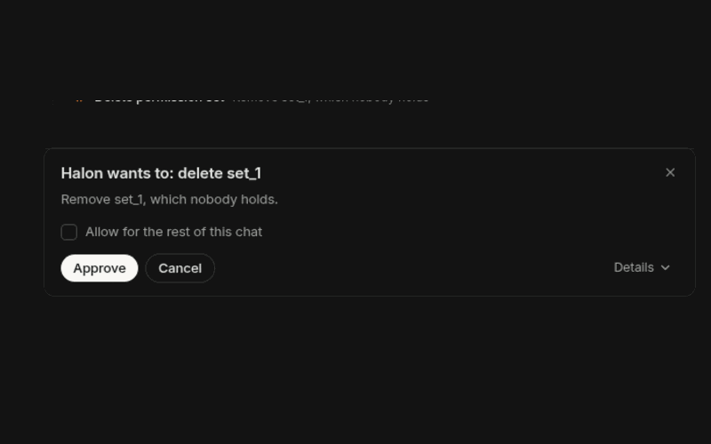
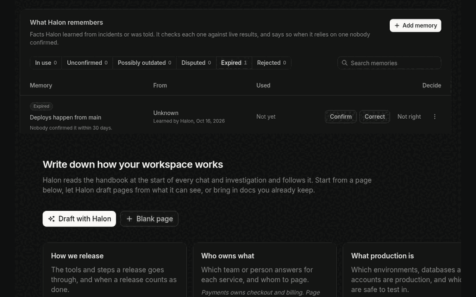
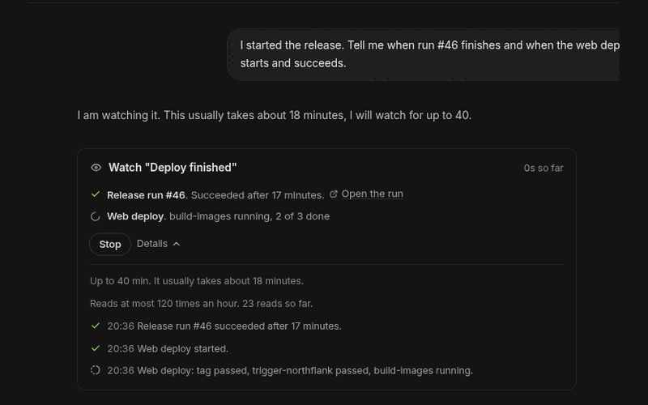
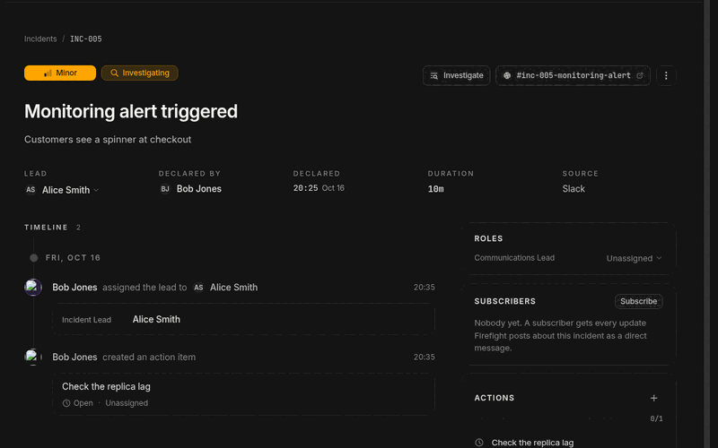
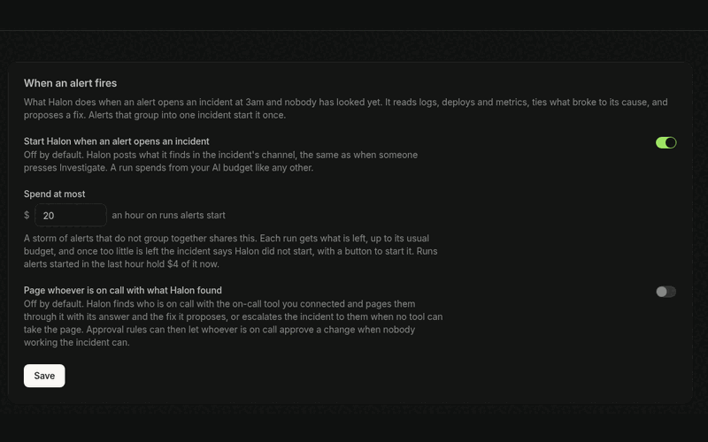
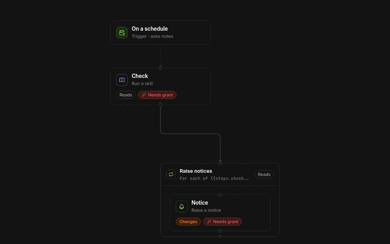
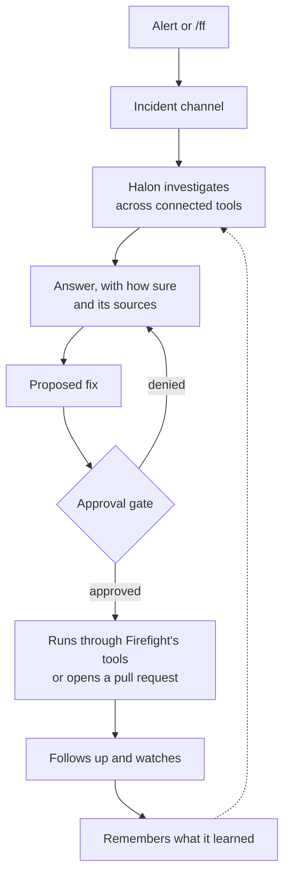

<p align="center">
  <a href="https://firefight.app">
    <picture>
      <source media="(prefers-color-scheme: dark)" srcset=".github/assets/readme-hero-dark.svg" />
      <source media="(prefers-color-scheme: light)" srcset=".github/assets/readme-hero-light.svg" />
      
    </picture>
  </a>
</p>

<p align="center">
  <a href="LICENSE"></a>
  <a href="https://github.com/FireFightLabs/firefight/actions/workflows/ci.yml"></a>
  <a href="https://github.com/FireFightLabs/firefight/tags"></a>
  <a href="https://firefight.app/docs"></a>
  <a href="https://github.com/FireFightLabs/firefight/stargazers"></a>
  <br />
  <a href="SELF_HOSTING.md"></a>
  <a href="https://firefight.app"></a>
</p>

<p align="center">
  <a href="https://firefight.app">Website</a> ·
  <a href="https://firefight.app/docs">Docs</a> ·
  <a href="SELF_HOSTING.md">Self-hosting</a> ·
  <a href="#quick-start">Quick start</a> ·
  <a href="https://firefight.app/slack">Community</a> ·
  <a href="https://x.com/firefightapp_">X</a>
</p>

<p align="center">
  
</p>

**Firefight is an open-source AI SRE.** Its agent, Halon, starts on an alert or a question, reads your connected tools, tells you what broke and how sure it is, and fixes it once a person approves. It works inside a full incident platform that runs in Slack, which you can host yourself under the AGPL.

## Why Halon

### 🔎 It investigates, and says how sure it is
An alert that opens an incident can start Halon on its own. It posts a live checklist in the channel (recent deploys, logs and metrics, the code, the database, the resource map), then a short answer that names the cause, the facts behind it and the fix. Every answer says how sure Halon is, from "Very sure" down to "A guess", and what it could not check.

### 🛠️ It fixes, and asks first
Halon proposes a fix as steps and runs them through Firefight's own tools, or writes a code change in a sandbox and opens a pull request. Every change goes through one permission gateway. Reads are open to members by default, changes need a grant, approval rules hold the risky ones for an approver in Slack, and every call is written to an activity log with who asked and why.

### 🧭 It runs a whole incident, not just the investigation
Declare from `/ff` or an alert, get a channel with the right people, roles, a timeline, follow-ups and an AI-drafted postmortem. Page whoever is on call through your on-call tool, update your status page, automate the routine with workflows, and see what runs where on a resource map built from your connected providers.

### 🧠 It remembers, and your team decides what sticks
Halon keeps memories about your setup and learns from each incident. New ones are marked unconfirmed until a person confirms or rejects them. A handbook tells it how your workspace works, and when a reading contradicts a page, Halon proposes an edit that changes nothing until someone accepts it.

### 👀 It watches, and works in parallel
Ask Halon to follow a release or a deploy and it reports each milestone and when it finishes or fails. On a big question it hands narrow checks to helpers that run at the same time, each with exactly the reach of whoever asked.

### 🔗 It shows its sources, with your own AI key
Results link back to the page they came from, so every claim can be checked at its source. Connect providers from the built-in registry or any MCP server. Bring your own key for Anthropic, OpenAI, Gemini, Vertex AI, Bedrock, Azure, OpenRouter, DeepSeek, Mistral or xAI, or a local model when you host it yourself. Credentials are encrypted at rest and never reach the model.

## Features

<table>
  <tr>
    <td width="50%" valign="top">
      
      <h3>Investigate</h3>
      The answer, the theories Halon ruled out, and every step it took to get there, each with what it read.
    </td>
    <td width="50%" valign="top">
      
      <h3>Fix with approval</h3>
      Every change is one plain card saying what Halon wants to do. Approve it, cancel it, or open the details first.
    </td>
  </tr>
  <tr>
    <td valign="top">
      
      <h3>Memory and handbook</h3>
      What Halon learned, waiting for a person to confirm it, and the pages that tell it how your team works.
    </td>
    <td valign="top">
      
      <h3>Watches</h3>
      Ask Halon to tell you when a run finishes. It learns how long that usually takes and says when it is late.
    </td>
  </tr>
  <tr>
    <td valign="top">
      
      <h3>Incidents in Slack and on the web</h3>
      Declare, update, assign a lead and resolve in Slack. The incident page keeps the timeline, roles and follow-ups in step.
    </td>
    <td valign="top">
      
      <h3>On-call</h3>
      Start Halon when an alert opens an incident at 3am, cap what those runs spend, and page whoever is on call with what it found.
    </td>
  </tr>
  <tr>
    <td valign="top">
      
      <h3>Workflows</h3>
      Triggers, Halon steps, approvals and tool calls on a canvas, or a ready-made check from the library.
    </td>
    <td valign="top">
      
      <h3>Resource map</h3>
      What runs where, what depends on what and what changed, read from your connected providers.
    </td>
  </tr>
</table>

## How it works



1. **Something breaks.** An alert reaches a routing rule that opens an incident, or someone runs `/ff` in Slack. Firefight opens the channel and pulls in the right people.
2. **Halon investigates.** It reads deploys, logs, metrics, traces, the code, the database and the resource map through your connections, and posts its progress as a checklist.
3. **It answers.** A short answer in the channel, the full reasoning in the thread, every claim linked to where it came from.
4. **It fixes, with permission.** Each step goes through the gateway. A change your rules hold waits for an approver, then runs and reports how it went.
5. **It follows up.** Watches report on the deploy that ships the fix, the postmortem is drafted from the timeline, and what Halon learned waits for your team to confirm.

## Integrations

Every provider below comes from one registry, [`config/integration_providers.yml`](config/integration_providers.yml). Anything else with an MCP server connects as a custom server.

<table>
<tr><td><b>Cloud and hosting</b></td><td>&nbsp;Northflank &nbsp; &nbsp;Cloudflare &nbsp; &nbsp;Kubernetes &nbsp; &nbsp;Modal &nbsp; &nbsp;DigitalOcean &nbsp; &nbsp;Netlify<br />&nbsp;Convex &nbsp; &nbsp;Trigger.dev &nbsp; &nbsp;AWS &nbsp; &nbsp;Google Cloud &nbsp; &nbsp;Azure &nbsp; &nbsp;Vercel<br />&nbsp;Render &nbsp; &nbsp;Railway &nbsp; &nbsp;Fly.io</td></tr>
<tr><td><b>Observability</b></td><td>&nbsp;New Relic &nbsp; &nbsp;Datadog &nbsp; &nbsp;Grafana &nbsp; &nbsp;Sentry &nbsp; &nbsp;Honeycomb &nbsp; &nbsp;Axiom<br />&nbsp;Better Stack &nbsp; &nbsp;Logfire &nbsp; &nbsp;OpenStatus &nbsp; &nbsp;Honeybadger &nbsp; &nbsp;SigNoz</td></tr>
<tr><td><b>Alerting and on-call</b></td><td>&nbsp;PagerDuty &nbsp; &nbsp;Opsgenie</td></tr>
<tr><td><b>Status pages</b></td><td>&nbsp;Statuspage &nbsp; &nbsp;Instatus</td></tr>
<tr><td><b>Product analytics</b></td><td>&nbsp;PostHog &nbsp; &nbsp;Mixpanel</td></tr>
<tr><td><b>Databases</b></td><td>&nbsp;Neon &nbsp; &nbsp;Supabase &nbsp; &nbsp;PlanetScale &nbsp; &nbsp;ClickHouse &nbsp; &nbsp;Tinybird &nbsp; &nbsp;Turso<br />&nbsp;Upstash &nbsp; &nbsp;PostgreSQL</td></tr>
<tr><td><b>Code</b></td><td>&nbsp;GitHub &nbsp; &nbsp;GitLab &nbsp; &nbsp;Bitbucket</td></tr>
<tr><td><b>CI</b></td><td>&nbsp;CircleCI</td></tr>
<tr><td><b>Coding agents</b></td><td>&nbsp;Devin &nbsp; &nbsp;Cursor &nbsp; &nbsp;Factory</td></tr>
<tr><td><b>Issues</b></td><td>&nbsp;Linear &nbsp; &nbsp;Jira</td></tr>
<tr><td><b>Knowledge</b></td><td>&nbsp;Notion &nbsp; &nbsp;Confluence</td></tr>
<tr><td><b>Custom</b></td><td>&nbsp;Custom MCP server</td></tr>
</table>

## Quick start

### Firefight Cloud

Sign up at [firefight.app](https://firefight.app). Hosting, upgrades and AI included.

### Self-host with Docker Compose

You need a machine with Docker, a hostname pointing at it, and permission to install a Slack app. Budget about twenty minutes, most of it creating the Slack app.

```sh
git clone https://github.com/FireFightLabs/firefight.git && cd firefight
cp .env.selfhost.example .env

# Generate the secrets for .env
docker run --rm ghcr.io/firefightlabs/firefight:latest bin/rails secret
docker run --rm ghcr.io/firefightlabs/firefight:latest bin/rails db:encryption:init

docker compose up -d
```

1. **Create the Slack app.** Replace the seven `<base-url>` entries in [`config/slack_manifests/template.yml`](config/slack_manifests/template.yml) with your address, then create an app **From a manifest** at [api.slack.com/apps](https://api.slack.com/apps).
2. **Fill in `.env`.** Your hostname, a Postgres password, the secrets above, and the Slack app's Client ID, Client Secret and Signing Secret.
3. **Start it** with `docker compose up -d`. The first boot creates the databases and Caddy gets a certificate.
4. **Sign in with Slack** at your address. Firefight installs its bot and sets up your workspace. Run `/ff new` in any channel.

[SELF_HOSTING.md](SELF_HOSTING.md) covers every step in detail, plus upgrades, backups, sandboxes for reading code, and running without Compose.

### Required settings

| Variable | What it is |
|---|---|
| `FIREFIGHT_HOST` | The hostname Firefight answers on. Caddy gets its certificate for it |
| `POSTGRES_PASSWORD` | The password for the bundled Postgres |
| `SECRET_KEY_BASE` | From `bin/rails secret` |
| `ACTIVE_RECORD_ENCRYPTION_PRIMARY_KEY`, `_DETERMINISTIC_KEY`, `_KEY_DERIVATION_SALT` | From `bin/rails db:encryption:init`. Keep them safe, encrypted data cannot be read without them |
| `SLACK_CLIENT_ID`, `SLACK_CLIENT_SECRET`, `SLACK_SIGNING_SECRET` | From your Slack app's Basic Information page |

## Self-hosting settings that matter

Every variable is described in [`.env.example`](.env.example). These are the ones that change what Halon can do. With Docker Compose, add each one you set to `.env` and list it under the `firefight` service's `environment:` too.

| Variable | What it does |
|---|---|
| `ANTHROPIC_API_KEY`, `OPENAI_API_KEY`, `GEMINI_API_KEY`, `OPENROUTER_API_KEY` and the other `<PROVIDER>_API_KEY` settings | The install's own AI keys. Leave them empty and each workspace adds its own AI account under Settings, Workspace |
| `INVESTIGATION_AI_MODEL` | The model Halon's investigations and chats run on. Each purpose has its own `<PURPOSE>_AI_MODEL` and `_PROVIDER`, such as `POSTMORTEM_AI_MODEL` or `CITATION_CHECK_AI_MODEL` |
| `FIREFIGHT_AI_QUICK_MODEL`, `FIREFIGHT_AI_BACKUP_MODEL` | The model for quick side jobs, and the one Halon carries on with when the main model stops answering |
| `EMBEDDING_AI_MODEL` | The model for search embeddings |
| `SANDBOX_PROVIDER` | Where Halon reads and changes code: `docker`, `northflank` or `boat`. Left blank, code reading is off |
| `SANDBOX_BACKUP_PROVIDER` | A second sandbox provider for when the first cannot start a box |
| `APP_HOST` | The dashboard's host, for links Firefight posts to Slack |
| `SLACK_TEAM_ID` | Locks sign-in to one Slack workspace |
| `INTEGRATION_GITHUB_CLIENT_ID`, `INTEGRATION_GITHUB_CLIENT_SECRET`, `INTEGRATION_GITHUB_APP_SLUG` | Your GitHub App, for connecting GitHub and opening pull requests |
| `SMTP_ADDRESS`, `MAIL_FROM`, `GOOGLE_CLIENT_ID` | Email link and Google sign-in |
| `OPERATOR_USER_IDS` | Who may open the operator console at `/operator` |
| `SENTRY_DSN` | Send the install's own errors to your Sentry |

Your instance talks to Slack, to Postgres, to the AI providers you configure and to the tools you connect. It sends us nothing.

## Safety and your data

- **Reads and changes are different.** Members read every connected tool by default. A tool that changes something needs a grant, usually a connection's changes pack, and machines such as API keys and agents hold nothing they were not granted.
- **Approval rules hold the risky calls.** A held call becomes a request in Slack for the approvers the rule names, and runs only once one of them approves.
- **Unattended means on your terms.** Halon acts on its own when nobody is around only under rules your team writes, checks each against a fresh reading first, and says in the channel what it did and how to undo it.
- **Secrets stay out of the model.** Credentials are encrypted at rest and never shown back. Tools that would return a secret are refused or have it taken out of the answer, and a secret a tool needs is typed by the person, never seen by Halon.
- **Everything is on the record.** Every privileged call is written to the activity log before it runs, with who asked, for what, and whether it was allowed, refused or held. Every AI call is recorded with its tokens and cost.
- **Channel transcripts are opt-in.** Halon reads what people said in an incident channel only after an admin turns it on, with secrets scrubbed before storage and a retention window you set.

### How quality is measured

Halon has a bench of 42 recorded scenarios in [`config/halon_bench`](config/halon_bench). Every tool call is answered from the scenario's world, so nothing outside Firefight is reached, and a judge model scores each answer. CI replays the bench on every pull request that touches Halon's prompt, tools or loop, and fails when the score drops by more than the noise. Run it yourself:

```sh
bin/rails "halon:chat_bench[MODEL,PROVIDER]"
```

## Built for agents too

- **REST API** at `/api/v1`, with bearer tokens, per-key permissions and idempotency keys
- **MCP server** at `/mcp`, so your own agent can run an incident or set up a workspace over the same gateway, under its own name
- **Outbound webhooks** for incident events, with delivery tracking and retries

## Status

Firefight is young and moving fast. Every version is tagged from `main` and published as a multi-arch image at `ghcr.io/firefightlabs/firefight`, the same image Firefight Cloud runs. Slack is the only chat platform today. Expect breaking changes before 1.0, and read each release's upgrade notes before you pull it.

## Local development

```sh
mise install                          # Ruby and Node
docker run -d --name firefight-postgres -e POSTGRES_USER=postgres \
  -e POSTGRES_PASSWORD=postgres -p 5432:5432 \
  -v firefight-postgres-data:/var/lib/postgresql pgvector/pgvector:pg18
bundle install && npm install
bin/rails db:prepare && bin/rails db:prepare RAILS_ENV=test
bin/dev
```

[CONTRIBUTING.md](CONTRIBUTING.md) has the full setup, including the Slack app for development, the environment variables and the tunnel for Slack callbacks. Engineering references live in [`docs/`](docs/).

## Contributing

Bug reports, fixes and features are welcome. Start with [CONTRIBUTING.md](CONTRIBUTING.md) and [CODE_OF_CONDUCT.md](CODE_OF_CONDUCT.md). Pull requests from forks run the full CI suite with no secrets needed.

Found a vulnerability? Report it privately as [SECURITY.md](SECURITY.md) describes, never in a public issue.

## Community

- Docs at [firefight.app/docs](https://firefight.app/docs)
- Chat with us in the [community Slack](https://firefight.app/slack)
- Follow [@firefightapp_](https://x.com/firefightapp_) on X
- Talk to us about running it at your company at **hello@firefight.app**

## License

[AGPL-3.0](LICENSE) © Firefight Labs. Free to use, self-host and change. If you run a changed version as a service, share your changes under the same license.

<a href="https://star-history.com/#FireFightLabs/firefight&Date">
  <picture>
    <source media="(prefers-color-scheme: dark)" srcset="https://api.star-history.com/svg?repos=FireFightLabs/firefight&type=Date&theme=dark" />
    
  </picture>
</a>
